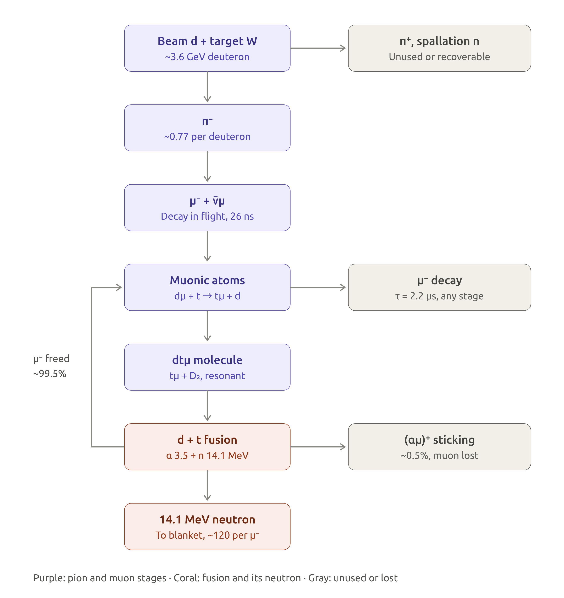
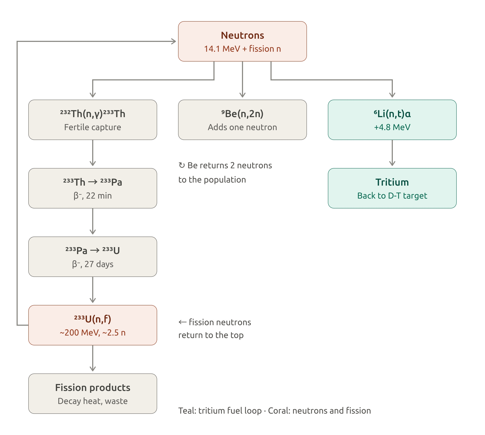
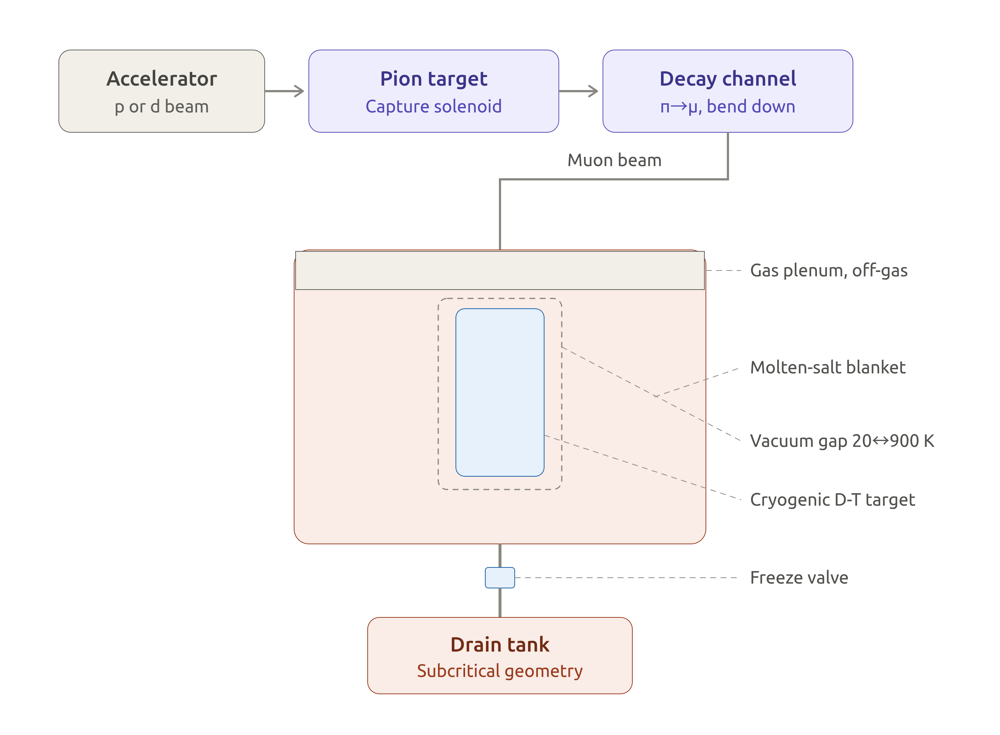
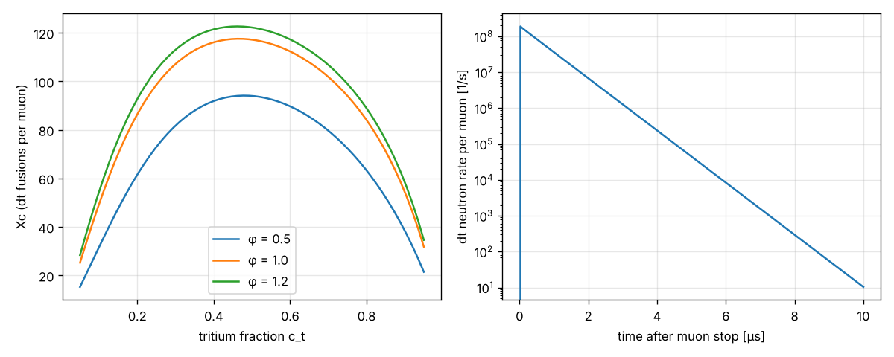
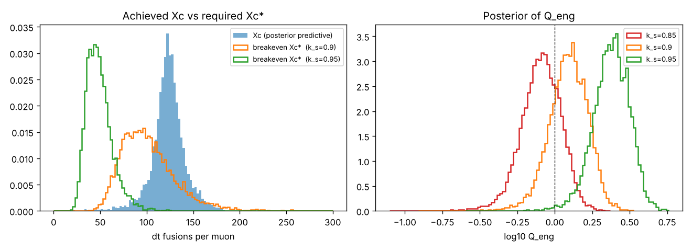

# Estimation of Energy Payback Ratio of Muon-catalyzed fusion/ Nuclear fission brancket Hybrid reactor

## Usage
```
python test_layer1_closed.py                  # test for closed form
python mucf_bayes_layer1.py --synthetic-check # test for pipeline
python mucf_bayes_layer1.py --sensitivity     # estimation using real data and sensitivity table
python mucf_bayes_layer1.py --design-T 300 --design-phi 0.8 --design-ct 0.5
```
## Construction
### Basic Reaction

Nuclear fusion catalyed by muons


Nuclear fission



### Skech of Reactor



## Basic Estimation of efficienty

### muCF kinetics (layer1)

- mucf_layer1_closed.py

Closed-form solution of the 5-state model of layer 1

- mucf_kinetics.py
 Rate-equation model of muon-catalyzed fusion (μCF) in D/T mixture

 
### blanket  (layer2)
- mucf_blanket_openmc.py

Neutron transport model of a μCF neutron source + molten-salt blankt

### Energy Payback Ratio (layer3)
- mucf_energy_balance.py — Energy balance Q_eng of a μCF fission hybr

$Q_{\text{eng}} = \frac{\eta_{\text{th}} \cdot X_c \cdot \left[\, 17.6\ \text{MeV} + E_f \cdot \dfrac{k_s}{\nu(1-k_s)} \,\right]}{E_\mu / \eta_{\text{acc}}}$

- η_t: Thermal-electric convert efficiency
- E_f: energy per one nuclear fission （about 200 MeV）
- k_s: amplification coefficient against source neutron
- ν: neutron number per one fission
- E_μ:eenery ot generate of one muon
- η_acc: Electric efficiency of acceralator

## Probablistic (Bayesian) Extimation
mucf_bayes.py

mucf_bayes_layer1.py

### Result


## Reference
- [Breunlich et al., Muon-Catalyzed Fusion (Annual Reviews)](https://annualreviews.org/content/journals/10.1146/annurev.ns.39.120189.001523)
- [Ponomarev, Muon catalysed fusion (Scilit)](https://annualreviews.org/content/journals/10.1146/annurev.ns.39.120189.001523)
- [Jones et al., Observation of unexpected density effects (OSTI)](https://annualreviews.org/content/journals/10.1146/annurev.ns.39.120189.001523)
- [Kamimura, Kino, Yamashita, arXiv:2112.08399](https://annualreviews.org/content/journals/10.1146/annurev.ns.39.120189.001523)
- [Wu & Kamimura, arXiv:2401.17358](https://annualreviews.org/content/journals/10.1146/annurev.ns.39.120189.001523)
- [External-Field-Assisted Muon Reactivation, arXiv:2606.07077](https://annualreviews.org/content/journals/10.1146/annurev.ns.39.120189.001523)
- [LANL report (FAS mirror)](https://annualreviews.org/content/journals/10.1146/annurev.ns.39.120189.001523)

-[Jones et al., Experimental Investigation of Muon-Catalyzed d-t Fusion (PRL 51, 1757)](https://link.aps.org/doi/10.1103/PhysRevLett.51.1757)
-[Jones, Muon-Induced Fusion: Experiments at LAMPF (OSTI)](https://www.osti.gov/servlets/purl/5521098-ux3uMX/)
-[Petitjean, Muon Catalyzed Fusion (OECD/NEA)](https://www.oecd-nea.org/trw/docs/villigen/vil-3-04.pdf)
-[Kamimura, Kino, Yamashita, arXiv:2112.08399](https://arxiv.org/abs/2112.08399)

-[Kelly et al., An investigation of efficient muon production for use in muon catalyzed fusion (J. Phys. Energy 3, 035003, 2021)](https://www.doi.org/10.1088/2515-7655/ABFB4B)
-[MuSIC muon source (Phys. Rev. Accel. Beams 20, 030101)](https://discovery.ucl.ac.uk/1551608/1/PhysRevAccelBeams.20.030101.pdf)
-[MuSIC: arXiv:1610.07850](https://ar5iv.arxiv.org/html/1610.07850)

-[Myrrha protons accelerated for first time (World Nuclear News)](https://wnn.world-nuclear.org/articles/myrrha-protons-accelerated-successfully)
-[MYRRHA: an accelerator driven system to manage radioactive waste (IAEA)](https://iaea.org/bulletin/myrrha-an-accelerator-driven-system-to-manage-radioactive-waste)
-[Cutting-edge accelerator technologies are key to success for the MYRRHA research reactor (Physics World)](https://physicsworld.com/cutting-edge-accelerator-technologies-are-key-to-success-for-the-myrrha-research-reactor/)

- [OpenMC](https://docs.openmc.org/en/stable/index.html)
- [Wikipedia Muon catalyzed fusion](https://en.wikipedia.org/wiki/Muon-catalyzed_fusion)
